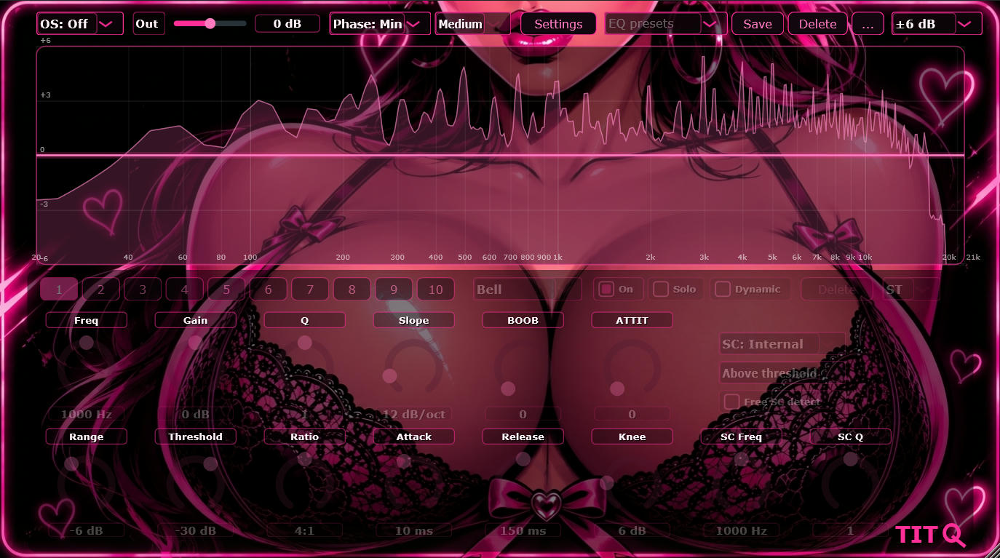

# TIT Q

**Free 10-band equaliser (VST3 for Windows and macOS, AU for macOS)** with per-band dynamics, sidechain, character bands and **minimum, linear or mixed phase**. No registration, no ads, no limits.

## Features
- 10 bands: bell, low/high shelf, low/high cut (continuous slopes from 6 dB/oct up), tilt shelf, and character bands: **SLTIT, TIT 250, AP TIT, TIT SKY, BOOBTEC**. The character bands follow curves measured on reference equalisers (frequency, Q and gain interaction).
- **Dynamic bands**: each band can compress or expand by level, with its own detector, attack and release, and an internal or external sidechain.
- Stereo, Mid/Side or L/R processing, solo per band, live curve with the resting-dynamics "ghost" curve, spectrum analyser.
- Clean start: no bands. One click on an empty part of the graph creates a band in the first free slot; double-click switches it on or off. A click at the very low end creates a high-pass; at the high end, a low-pass.
- Presets (`.json`), with a default preset, and a Settings button for click actions.

## Phase
- **Min**: minimum phase, with optional oversampling.
- **Linear**: the ten bands become one symmetric FIR filter with no phase shift. The plugin reports its latency to the host.
- **Mixed**: minimum phase below ~500 Hz and linear phase above it. Bass without pre-ringing, treble without phase shift; same magnitude and latency as Linear.
- **Quality** Low / Medium / High / Max sets the filter length. At 48 kHz the latency is 1280 / 2304 / 4352 / 8448 samples. More quality means more precision in the bass and more latency.
- Linear-phase filters produce pre-ringing on steep cuts and strong bass boosts; that is inherent to linear phase.

## Character bands
- **TIT 250**: bell with adjustable Q from 0.393 (wide) to 2.121 (narrow).
- **TIT SKY**: 12 dB/oct high shelf whose frequency and Q follow measured curves as the gain increases (up to 10.14 dB).
- **BOOBTEC**: low-shelf type with a four-position frequency selector (20 / 30 / 60 / 100), boost (BOOB) and attenuation (ATTIT) controls.
- **AP TIT**: bell with automatic Q that depends on the gain.

## Engine
Coefficients are interpolated sample by sample (no zipper noise), bells and shelves near Nyquist are designed against the analogue prototype so oversampling is not needed, and the ten bands are chained in 64-bit.

## Install
Download the latest build from *Actions* → artifact `TITQ-all`, copy `TIT Q.vst3` to your VST3 folder and rescan in your DAW.
Unsigned macOS builds: `xattr -cr "TIT Q.vst3"` (or `.component`).

## Build from source
`cmake -B build && cmake --build build --config Release`. Needs CMake 3.22+ and a C++17 compiler; JUCE 8 is downloaded automatically. Core tests (no JUCE): `g++ -std=c++17 -O1 tests/eq_test.cpp -o eq_test && ./eq_test`.

## License
Free software under the **GNU AGPLv3** (see `LICENSE`), built with JUCE 8. Source: https://github.com/TIT-Audio/TIT-Q
All trademarks belong to their owners; TIT Q is not affiliated with or endorsed by anyone.

---

## Resumen en español
TIT Q es un ecualizador gratuito de 10 bandas (VST3 y AU) con dinámica por banda, sidechain, bandas de carácter medidas (SLTIT, TIT 250, AP TIT, TIT SKY, BOOBTEC) y fase **mínima, lineal o mixta**. Se empieza sin bandas: un clic en la gráfica crea una. Licencia AGPLv3.
